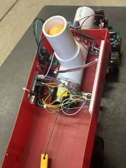
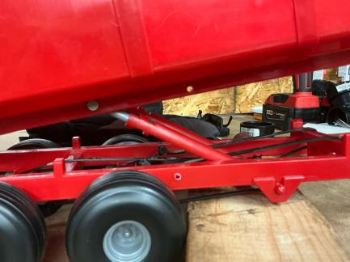
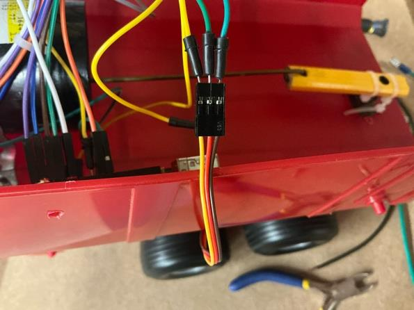

# Autonomous Search-and-Rescue Launcher Robot

First-year Cornerstone Design project ("Team Megabits"), University of Windsor. Team of 5, Jan 2026 - Apr 2026.

| Assembled launcher on trailer | Trailer and tandem axle | Onboard wiring |
|---|---|---|
|  |  |  |

## Problem
Design a fully autonomous robot that navigates an obstacle course and
accurately delivers emergency supplies to a search-and-rescue drop zone,
simulating relief delivery to a remote or inaccessible location.

## Requirements
- Autonomously navigate an obstacle course using onboard sensors/line-tracking
- Launch three payloads consecutively into a target zone 3 m away
- Catapult mechanism could not exceed the width of the robotic vehicle
- No permanent modification to the base robotic vehicle
- Fully autonomous operation, no human intervention during the run

## My Role: Design & Hardware Lead
- **Proposed the redesign** from an unreliable paintball-style plunger to the
  tow-behind flywheel launcher the team built
- **Led hardware planning and troubleshooting** for the onboard electronics
  (Arduino Uno, motor driver, 18 V flywheel motors, servo reload mechanism),
  and tested the navigation code with teammates
- **Contributed concept sketches and CAD**, and refined the AutoCAD drawing
  package and fabrication manual with teammates
- **Diagnosed the trailer-alignment problem** described below and proposed the fix

Coding and most of the fabrication were done by teammates.

## System Architecture
A trailer-mounted launcher, towed behind an autonomous line-following robot.
The car signals the trailer's onboard control system over a wired connection
once it detects the end of the course, triggering the reload/launch sequence
(piston-driven hopper, then flywheel launch, repeated 3 times).

## Design Decisions
- Chose a tow-behind trailer over an onboard-mounted launcher to allow a
  larger, stronger launcher without balancing it on the car itself
- Fixed-incline barrel for a consistent arcing payload trajectory
- Budget-conscious component selection: reused owned materials to bring the
  actual build cost to about $100 against a $319 full-retail estimate

## Results
Completed the course and launched all three payloads in under 5 seconds of
active launch time. Final full-run time: about 28-33 seconds.

## Challenges & Problem-Solving
The trailer had no independent stabilization and drifted out of alignment
with the car during sharp turns, since it simply followed the car's movement
rather than self-correcting. This required manual realignment during testing
and hurt payload accuracy. I traced it to a geometry issue (tandem axle
position relative to the trailer's center of mass) rather than a control or
code problem, and proposed the corrective redesign below.

## Proposed Improvements
- Reposition the tandem axle closer to the center of the trailer's base to
  reduce drift during turns
- Raise the barrel's angle further off the ground for a better arcing shot

## Repository Contents
- `docs/fabrication-guide.pdf`: fabrication manual
- `docs/parts-list.md`: parts list and costs
- `images/`: build photos by subsystem (trailer, barrel, reload system, mounting, wiring)
